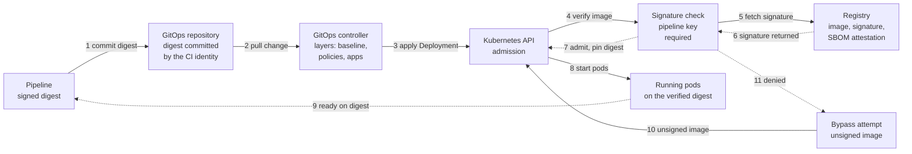

# The cluster runs only what the pipeline signed, and `kubectl exec` never reached the audit log

| | |
| --- | --- |
| **Time** | About 1 hour, 2 and 3 November 2026 |
| **CISSP domains** | 8 Software Development Security · 3 Security Architecture and Engineering · 7 Security Operations · 6 Security Assessment and Testing · 5 Identity and Access Management |
| **Lab at the start** | The `kind` cluster from [the previous entry](2026-10-31-k8s-gitops-audit-falco.md), managed by GitOps: Flux applies three layers in order, baseline → policies → apps. The API server audit log and Falco's alerts reach Malcolm, with monitors on control changes made outside GitOps. A demo app runs in the `shop` namespace with a known-vulnerable urllib3 (1.26.4) pinned on purpose. |

Two questions for this entry. Can I fix a vulnerable dependency and prove the app
still works, not only that the scanner went quiet? And can I make the pipeline the
only way an image gets into the cluster? A third turned up on the second day: who
ran `kubectl exec`? The audit log had never recorded it.

## A dependency fix, tested before it was trusted

Dependabot had eleven open alerts on the demo app's urllib3 1.26.4. 2.8.0 is the
lowest version that fixes every one, so the change itself was one line:

```text
urllib3==2.8.0
```

1.x to 2.x is a major version. A bump that passes the scan can still break the
app, so the bump came with a behaviour test that runs *inside* the built image
and makes real requests through the library:

```text
$ docker run --rm demo-app:v3 python /test_app.py
PASS installed urllib3 == pin | installed 2.8.0, pinned 2.8.0
PASS / reports the pinned version | 200 demo-app · urllib3 2.8.0
PASS /fetch goes through urllib3 | 200 fetch ok · upstream 200 · text/plain; charset=utf-8 · 26 bytes
PASS unreachable upstream -> clean 502 | 502 fetch failed: MaxRetryError
4/4 passed
```

The line to read is the third one. `upstream 200` means a request went out through
the new library's pool, retry and timeout code and came back. The fourth line
proves the error path still works under 2.x's exceptions.

A test that always passes proves nothing, so I ran it where it should fail: the
same Dockerfile and test with the old pin, on a `python:3.12` base.

```text
ModuleNotFoundError: No module named 'urllib3.packages.six.moves'
exit=1
```

The old version breaks on Python 3.12, and the test says so. Then I
re-scanned. grype and osv-scanner found nothing on the fixed requirements file,
grype found no urllib3 finding in the built image, and trivy's only Python
findings were in pip itself.

Last, the rollout. Three replicas, rolled from the old image to the new one, with
a client calling the Service every 200 ms the whole time:

```text
requests: 79  OK: 79  DROP: 0  served 1.26.4: 38  served 2.8.0: 41
```

`DROP: 0` is the field that matters. The client log shows the two versions
answering side by side for a second while the rollout moved across, then only
2.8.0.

## The pipeline as the only way in

Passing checks is not enough if something can reach the cluster without them.
The design is a chain where each link only accepts what the one before it
produced. The pipeline signs an image only after every gate passes. The cluster
admits an image only if it carries that signature, and the signing key is one
only the pipeline holds.

The pipeline runs on self-hosted Gitea Actions (`act_runner` 5.1.1). Gitea's
registry, `$IMAGE` below, holds the images, their cosign signatures and their
SBOM attestations. The workflow syntax is GitHub Actions', so it carries over.

### The checks, separate from the tools

I wrote the pipeline as a list of checks first and picked a tool for each one
second. The check is the requirement; the tool is how it is met today. When a
tool changes, its row changes and the check stays.

| # | Check (what must be true) | Tool today | Could be swapped for |
| --- | --- | --- | --- |
| 1 | Base image is the pinned digest and signed by its publisher | cosign 3.1.3, keyless verify of Chainguard | Notation |
| 2 | Source passes static checks | ruff 0.15.0 | flake8, Semgrep |
| 3 | Image builds from source, multi-stage | Docker BuildKit | Buildah, Kaniko |
| 4 | The built image behaves correctly | `test_app.py`, run inside the image | pytest, container-structure-test |
| 5 | Not root, no shell | `docker image inspect` and a shell probe | dockle, conftest |
| 6 | No fixable High or Critical vulnerability | trivy 0.75.0 and grype | Snyk, Docker Scout |
| 7 | Exact contents recorded | syft, SPDX JSON | cdxgen |
| 8 | Published by digest | crane 0.22.1 | docker or podman push |
| 9 | Signed by the pipeline, SBOM attested, own signature verifies | cosign 3.1.3 | Notation, cosign keyless |
| 10 | Deploys only as a git commit by the CI identity | git, as `ci-bot` | Flux image automation |
| 11 | What runs is what was signed, and it works | `kubectl` as a read-only identity | Flux or Argo health checks |
| — | The cluster runs only pipeline-signed images | Kyverno 1.19.1 | Sigstore policy-controller, Ratify |

The diagrams follow the same rule: boxes name what must be true, not the product.
This is the deploy half, read left to right. Solid arrows are requests, dashed
arrows are the answers coming back.



*Key:* 1 the pipeline commits the new digest to the GitOps repository; it never
deploys to the cluster itself. 2–3 Flux pulls the change and applies it. 4–6
admission asks Kyverno, which fetches the signature from the registry and checks
it against the pipeline's public key. 7 the pod is admitted with its image
rewritten to the verified digest. 8 pods start under Pod Security `restricted`.
9 a read-only identity confirms every pod is Ready and on that exact digest.
10–11 an unsigned image, through `kubectl` or through git, meets the same check
and is denied.

### What broke on the way to the first signed deploy

**Kyverno refused, for the wrong reason.** The first refusals looked like the
control working. Reading the message showed a 401: Kyverno could not log in to
the registry to fetch the signature at all. The chart-wide pull secret did
not apply to signature checks. The policy now names the credentials itself
(`imageRegistryCredentials`), using an identity that can pull and not push. I did
not count those first refusals as proof. A denial only counts when the reason is
the one you are testing.

**Kyverno could not read the signature format.** cosign 3 writes Sigstore bundles
by default, and Kyverno's `Cosign` verifier reads the classic `.sig` tag. The
pipeline signs with `--new-bundle-format=false`. Moving to the bundle format is a
follow-up.

**Two flags for one setting.** A workaround through the chart's `extraArgs` left
Kyverno running with both `--allowInsecureRegistry=false` and `=true`. I replaced
it with the chart's own `features.registryClient.allowInsecure`, so there is
exactly one. The lab registry is plain HTTP inside the cluster's network, which is
why the setting exists at all.

The policy's other important line is `mutateDigest: true`. Kyverno rewrites the
image reference to the digest it verified. A tag can be moved after the check. A
digest cannot.

Before the first run, the key I had used to test the setup was set aside and a
fresh one was made for the pipeline alone. On the test key I had already seen the
three admission cases: signed by the key, admitted with the image pinned to its
digest; unsigned, `no signatures found`; signed by another key, `invalid
signature`.

### Five runs, three of them failures

Runs 2 and 5 passed all eleven gates. The other three are the interesting ones.

**Run 1** died at checkout: `url contains a newline in its password component`.
The bot's secret had been saved with a trailing newline.

**Run 3** was meant to fail. I downgraded urllib3 to 2.0.6, a known-vulnerable
version, and pushed it. The behaviour test passed 4/4: the vulnerable version
*works*. The scan gate stopped it:

```text
Total: 6 (HIGH: 6, CRITICAL: 0)
##[error]Process completed with exit code 1.
```

Nothing was pushed, signed or deployed. This run is the reason the pipeline has
both a test and a scan. The test proves behaviour, the scan proves the version is
safe, and the signature proves both ran.

**Run 4** reverted the downgrade and failed anyway, at step 10:

```text
nothing to commit, working tree clean
##[error]Process completed with exit code 1.
```

The revert rebuilt source that was already deployed. The build is reproducible, so
it produced the same digest, and there was nothing to change in the GitOps
repository. `git commit` exits 1 when there is nothing to commit, and the step
treated that as fatal. The fix checks `git diff --quiet` first and treats "no
change" as already deployed, while still running the step 11 verification.
**Run 5** proved it:

```text
digest sha256:bd85dd28... is already the deployed one; no GitOps change
all demo-app pods Ready (readiness = /fetch through urllib3) and running sha256:bd85dd28...
```

## The negative test: a hand-built image, committed to GitOps

The last test was the one the design exists for. As cluster admin, I built a
vulnerable image (urllib3 2.0.6) by hand and pushed it straight to the registry,
skipping every gate. Digest `sha256:ea0f872f…`, no pipeline signature.

First through `kubectl`:

```text
$ kubectl set image deploy/demo-app -n shop <container>=$IMAGE@sha256:ea0f872f...
require-pipeline-signature:
  autogen-apps-images-signed-by-pipeline: 'failed to verify image ...: .attestors[0].entries[0].keys: no signatures found'
```

Denied, and the pods stayed on `bd85dd28…`, 3/3. Then the harder path: I committed
that digest to the GitOps repository, the way the pipeline would.

```text
$ kubectl -n flux-system get kustomization apps
Ready=False reason=ReconciliationFailed
Deployment/shop/demo-app dry-run failed: admission webhook "mutate.kyverno.svc-fail" denied the request:
require-pipeline-signature: ... no signatures found
```

Three fields answer the question. `Ready=False` says Flux refused the change.
The reason says Kyverno refused it during Flux's dry run, before anything was
applied. And `lastAppliedRevision` stayed on the last good deploy while the app
stayed healthy, so the refusal caused no outage. I reverted the commit and the
`apps` layer went Ready again.

## `kubectl exec`: a gap the audit log had

Falco sees a shell open inside a container. It does not see *who* ran `kubectl
exec`. That answer belongs in the API server audit log. I ran a test exec. It
worked, and the audit log had no record of it.

The cause, measured: kubectl 1.37 streams exec over WebSocket, and the API server
logs that as verb `get` with code 101, the protocol upgrade. The audit policy's
first rule drops every `get`, `list` and `watch` as read-only noise. Exec is not a
write, so it never reached the later rules. A shell into a running container was
being filed as a read.

Policy rules are first match, so the fix was a new rule above the drop:

```yaml
- level: Metadata
  resources:
    - group: ""
      resources: ["pods/exec", "pods/attach", "pods/portforward"]
```

`Metadata` keeps the request URI, which carries the command
(`?command=python&command=-c…`). It never logs the session's content. The API
server reads its audit policy only at start, so it was restarted.

The log shipper's filter needed a change too. I measured what an attempt writes:
every one, allowed or refused, produces both a `ResponseStarted` and a
`ResponseComplete` record. My first filter shipped refusals twice. After
measuring, it keeps `ResponseStarted` only: one record per attempt, written when
the shell *opens*. An interactive shell's `ResponseComplete` lands when it closes,
which could be hours later. The filter also decodes the command out of the URI
into its own field. It shipped through Git and Flux, like every other change.

The fire drill was one allowed exec and one refused attempt by a
service account with no rights in the namespace. The raw audit records:

```text
13:51:08.386041Z ResponseStarted  get    kubernetes-admin                       101 python -c print("drill-allowed")
13:51:08.386041Z ResponseComplete get    kubernetes-admin                       101 python -c print("drill-allowed")
13:51:08.483358Z ResponseStarted  create system:serviceaccount:shop:default     403 cat /etc/shadow
13:51:08.483358Z ResponseComplete create system:serviceaccount:shop:default     403 cat /etc/shadow
```

Read the user, the code and the command: who, whether it was allowed, and what
they tried to run. In Malcolm's Dashboards, Discover in DQL mode, window
2026-11-03 13:50 to 13:55 UTC:

```text
event.module:"k8s-audit" and miscbeat.k8s_resource:pods and miscbeat.k8s_subresource:(exec or attach or portforward)
```

It should return two records, the `ResponseStarted` one for each attempt. The
monitor `k8s-pod-exec` runs the same filter every minute over the last five
minutes and alerts once per user. At 13:51 UTC it showed 2 active alerts, one for
each user in the drill.

**The limit, stated.** A refused *kubectl* exec stops at its first step: kubectl
reads the pod first, that read is refused, and the policy drops reads. So a
refused attempt shows up here only when the caller can read pods but not exec, or
calls the exec endpoint directly, as the drill did. An outsider using kubectl
leaves only denied `get`s. Those are reconnaissance to hunt for, not an alert.

## What I learned

- **A test and a scan answer different questions.** The scan going quiet said
  2.8.0 was safe; only the test inside the image said the app still worked. And
  the vulnerable 2.0.6 image passed every behaviour test. With tests alone, the
  pipeline would have shipped it.
- **Read the reason on every denial.** Kyverno's first refusals were 401s, not
  missing signatures. They looked like success and proved nothing.
- **"Nothing to do" is a valid result.** A reproducible build of deployed source
  should end in "already deployed", not a failed run that trains people to
  ignore failures.
- **Audit policies are first match, and verbs do not mean what they sound like.**
  An exec over WebSocket is a `get`. A rule meant to drop noise was dropping every
  shell into a container. I only found it by running an exec and looking for it.
- **Write down the checks, not the tools.** Keeping the two apart in the table and
  the diagrams means a tool swap changes one row and nothing else.

On AKS, the managed equivalent is ACR with Defender for Containers scanning, cosign
or Notation signing, and AKS Image Integrity or Kyverno at admission. The exec gap
is the first thing I would check there: `kube-audit-admin` leaves out `get` and
`list`, so a WebSocket exec may be missing from it. I have not tested that.

## Next

- Require the SBOM attestation, and a scan-result attestation, at admission, not
  only the signature.
- Move to the Sigstore bundle format and Kyverno's `ImageValidatingPolicy`.
- Alert in Malcolm when a Flux Kustomization goes `Ready=False`, since that is
  what a refused deploy looks like.
- Wire a notification channel, so an alert reaches a person.
