# RAG apps: what they are, and how we test them

A primer for anyone following this journal. **Part 1** is what a
retrieval-augmented-generation (RAG) app *is* — an architecture you can map onto
any real product. **Part 2** is how the lab attacks one across the monitored
wire. Everything here is from public documentation against a synthetic target (a
fictional bakery's support bot); nothing comes from any real environment.

Open on GitHub or in a Markdown preview to see the diagrams rendered.

## Part 1 — What a RAG app is

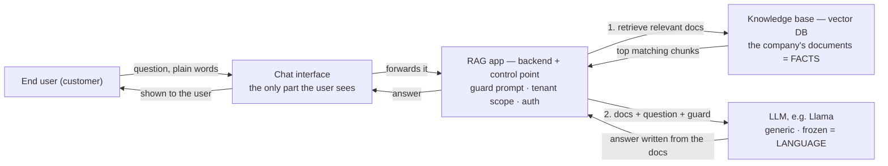

A RAG app answers questions using a company's **own** documents, without ever
retraining the model. Two activities people mix up:

- **Training** builds the model's brain from scratch — a huge slice of text,
  billions of weights, weeks on GPUs. Done once, upstream (the model's maker).
  This is the only place "learning" happens.
- **Inference** is *using* that finished, frozen brain to answer. That is all
  the model does in a RAG app; the weights never change.

So the model was never taught about this company. RAG gets around that like an
**open-book exam**: on each question the app finds the right page and pastes it
into the prompt — *"Using this document, answer…"* — and the model reads it in
context. No retraining.

The layering, front to back:

| layer | what it is |
| --- | --- |
| **Chat interface** | the text box; the only part the end user touches |
| **RAG app** | the company's backend and control point — guard prompt, tenant scope, auth; it orchestrates embed → retrieve → generate |
| **Knowledge base** (vector DB) | the company's documents = the **FACTS** |
| **Model** (the LLM) | generic, frozen = the **LANGUAGE** |

One question, start to finish (a customer-support bot):

1. A user types *"How do I reset my password?"* in the chat box.
2. The chat UI hands it to the RAG app.
3. The app embeds the question and **searches the knowledge base** for the few
   most relevant articles, scoped to that customer's tenant.
4. The app builds the prompt — *"Using these articles: […], answer: how do I
   reset my password?"* — and sends it to the model.
5. The model writes the answer **from those articles**; the app returns it.

The one line to remember: **the model does not hold the answers; the knowledge
base does.** Facts from the documents, phrasing from the model.

## Part 2 — How the lab tests it

Because the model is frozen, the attack surface is the **app**, not the weights:
the **prompt** (injection) and the **retrieval** (which documents get pulled, and
whether the tenant boundary holds). The lab drives an LLM vulnerability scanner
at the running app from the Kali workstation, and the sensor records the traffic
like any other attack on the wire.

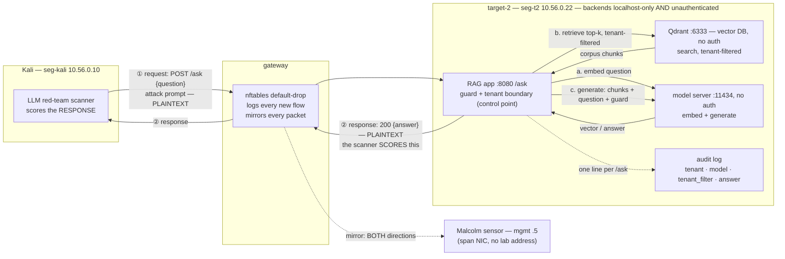

Reading it: ① is the attack request, ② is the response — and the scanner scores
**②**, the model's answer, not what was sent (success is measured on what comes
back). The RAG app is the front door and control point; behind it, all on
localhost, sit the **vector DB** (retrieval, enforcing the tenant boundary in its
query filter) and the **model server** (embeddings and generation). Both
directions of `/ask` are plaintext, so the sensor mirrors every prompt *and*
every answer — the attack and its effect are both on the record.

Two facts the first drafts left out. The app writes **one audit line per
question** (tenant, model, whether the tenant filter was on, the answer) — the
lab's application-side detective control, and where the next detection work
looks. And both backends are **unauthenticated** (the vector DB's key is empty,
the model server has none): localhost binding is the *only* thing between a
foothold on target-2 and full read/write of the corpus and the model. One
control, not defense in depth.

### Backend routing order

The diagram above shows *where* the backends sit; this shows the *order* the RAG
app calls them. One `/ask` is **three** backend calls, always in the same
sequence — embed, then search, then generate:

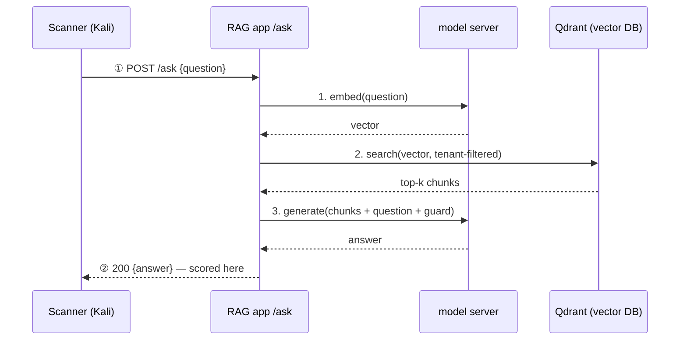

The order is forced, not a choice: you can't query the vector DB until the
question *is* a vector, and only the model server makes one; and you can't
generate the answer until retrieval has handed back the documents to put in the
prompt. `embed → retrieve → generate`, every time — the model server is hit
twice per call (once to embed, once to generate).

### The ingest pipeline (offline) — where documents enter

Everything above is the *query-time* path. Documents enter by a separate,
operator-run job — and that job is where indirect injection and poisoning get in,
so it belongs on the map.

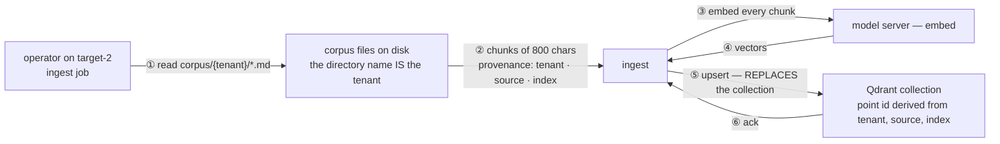

This is **TB5**. Today nothing a user types reaches it — only files an operator
placed — and **ownership comes from the load path, never from anything written
inside a file**: a document cannot claim another tenant. That is the control that
makes indirect injection a *planting* problem rather than an open door; the
Milestone 5 canary had to be put here by the operator. If user-submitted content
were ever ingested, this pipeline becomes the attack surface (LLM01 indirect,
LLM04 poisoning) and needs provenance plus a source allowlist at this step. Note
"replaces the collection": a re-ingest wipes and reloads — an availability and
integrity consideration, and also how you clean a poisoned corpus.

Two boundaries worth naming, because they are two different tests:

- **The prompt** — an attacker typing into the chat box tries injection or a
  jailbreak (the request *is* the payload). This is *direct* prompt injection.
- **The retrieval** — if user-submitted text ever reaches the knowledge base, an
  attacker can plant an instruction there for an innocent user's question to pull
  back later. This is *indirect* injection, the stored-XSS shape. And the tenant
  filter on the retrieval query is its own boundary: break it and one tenant
  reads another's documents.

## Security architecture: trust boundaries and where controls go

Threat modeling draws **trust boundaries** — the lines where data crosses from a
less-trusted zone into a more-trusted one. Every crossing is where threats
concentrate and where a control has to sit. Read the lanes top (least trusted) to
bottom (most trusted); TB1–TB5 are the boundaries.

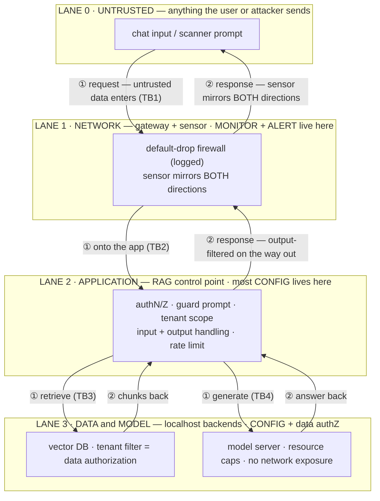

Both directions matter: the response (②) crosses the same boundaries outward, and
controls act on it too — output handling at the app (TB1/TB4) and the sensor
mirroring both ways at TB2. Each boundary needs controls in three disciplines — **configuration** (set once,
preventive), **monitoring** (continuous, detective), and **alerting** (fires on a
condition):

| boundary | top threat (OWASP LLM) | configuration (prevent) | monitoring (detect) | alerting (fire on) |
| --- | --- | --- | --- | --- |
| **TB1** input → app | LLM01 injection / jailbreak | authN/Z, guard prompt, input validation, rate limit | log every request **and** response | injection/jailbreak signatures; auth failures; request spikes |
| **TB2** the wire | sniffing, unauthorized access | default-drop firewall; **TLS** (if the path is plaintext, that's a gap) | sensor mirrors both directions | IDS rules on the mirror; unexpected new flows |
| **TB3** app → vector DB | LLM08 cross-tenant retrieval (RAG IDOR) | enforce the tenant filter; least-privilege DB creds | log retrievals with the tenant | a query that crosses tenants; abnormal result volumes |
| **TB4** app → model | LLM07 prompt leak · LLM05 output handling · LLM10 unbounded use | guard prompt, output encoding, token/time caps, backends localhost-only | usage + latency metrics; error (502) rate | DoS / 502 spikes; latency blowups; refusal-rate drops |
| **TB5** ingest → KB *(if user content is ever ingested)* | LLM01 indirect injection · LLM04 poisoning | provenance + source allowlist at ingest | ingestion log | ingestion from an untrusted source |

That table is what a boundary *should* have. The lab has some of it and not the
rest — and a review that can't tell the two apart is a brochure. **Lab gap
analysis**, with how each present control is verified *live*, not in source:

| control | in the lab today? | how it is verified live |
| --- | --- | --- |
| authN — Bearer key, constant-time compare, reused keys rejected | yes | a wrong key gets 401 |
| tenant boundary — vector DB `tenant` filter, inside the query | yes, as a per-call flag (default on) | every audit line records `tenant_filter` and the tenant of each retrieved hit |
| guard prompt — "answer only from context", "say you do not know" | yes, hardcoded in the server | removed in the harness and measured (Milestone 5) |
| request + response logging | yes — the audit log | the file grows one line per `/ask` |
| default-drop firewall, flow logs, mirror | yes — the gateway | nft counters; the sensor sees both directions |
| backends not network-exposed | yes (localhost) — **but unauthenticated** | `:6333` and `:11434` closed from Kali |
| TLS on `/ask` | **no** — plaintext | — |
| request body-size cap on `/ask` | yes — 413 over the cap | send an oversized body |
| rate limiting, token or time caps | **no** | one heavy probe family 502'd the model |
| output filtering, PII redaction | **no** | — |
| separate guardrail service | **no** | — |
| WAF, API gateway, SSO | **no** (lab scope) | — |
| per-user identity | **no** — the key both authenticates *and* selects the tenant | — |

Defense in depth: no single control is the whole answer. The guard prompt
(TB1/TB4) *reduces* injection but can't eliminate it; the sensor (TB2) catches
what the app misses; the tenant filter (TB3) is the only thing standing between
tenants. Remove any one and the layer behind it has to hold — which is exactly
what this lab proves, by removing a control and measuring the result.

## What an architect reviews in a plan like this

Walking the diagram, an architect asks, roughly in order:

1. **Trust boundaries** — where does untrusted data cross into a trusted zone,
   and is there a control at *every* crossing? Gaps here are the findings.
2. **Data flow and classification** — what data moves where, and what is
   sensitive (the corpus, the system prompt, the API key, tenant data)? Does it
   ever cross a boundary it shouldn't?
3. **AuthN vs AuthZ** — *who you are* (the key at TB1) is not *what you may see*
   (the tenant filter at TB3). Both must exist, each at the right boundary. In
   this lab the one key does both jobs — it authenticates *and* selects the
   tenant, with no per-user identity. Fine for a lab; a gap in a product, where a
   leaked key would be a whole tenant, not a user.
4. **Preventive *and* detective** — is each boundary both hardened (config) and
   observed (monitoring + alerting)? A control you can't detect failing is a
   control you can't trust.
5. **Blast radius / least privilege** — if the model is jailbroken, what can it
   reach? If the tenant filter breaks, who's exposed? If a backend were exposed,
   what's lost? Keep each component reachable only by the one in front of it.
6. **Observability and evidence** — can you *prove* a control works and *see*
   when it fails? Is the monitoring placed to see the attack (plaintext on the
   wire) or blind to it (an encrypted tunnel to a backend)?
7. **Assumptions and residual risk** — what's assumed (model frozen, backends
   localhost-only) and what residual risk is accepted (injection reduced, not
   eliminated)? State it; don't bury it.
8. **Live versus source** — a control that exists as a flag or a line of code is
   not a control until the running instance proves it is on. Here the tenant
   filter is a per-call boolean, so the proof is the audit line that records it;
   the guard was proved by removing it and measuring. Review the live posture,
   not the repository.

## Three postures: no gateway, the lab, and enterprise

The trust-boundary logic doesn't change with scale — only the *number* of
boundaries and how *dedicated* the controls are. Three points on that spectrum.

### A. No gateway (minimal) — what you lose

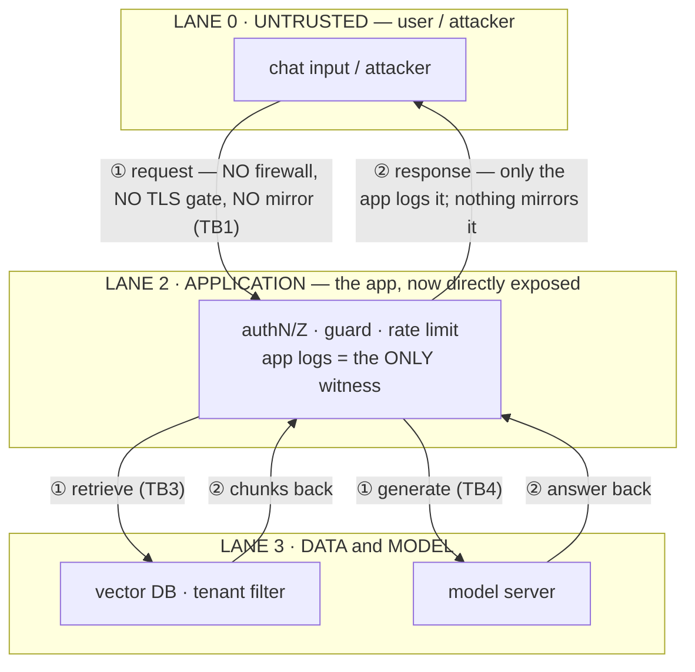

**The NETWORK lane is gone.** No default-drop firewall, no flow logs, no traffic
mirror → the sensor is blind, so all of TB2's config/monitoring/alerting
vanishes. Detection collapses onto the app's own logs: if the app is compromised
or its logging is off, *nothing independent* sees the attack. A flat network also
lets any other host reach the app — and maybe the backends, if they aren't
strictly localhost-bound — so lateral movement is trivial. This is the "trust the
app or trust nothing" posture, and it's how most quick demos ship.

### B. The lab — a gateway adds an independent layer

The lab's gateway restores **LANE 1 / TB2** (shown earlier): a default-drop
firewall (config), flow logs plus a traffic mirror (monitoring), and IDS rules on
the mirror (alerting) — an independent control *and* witness the app can't
provide for itself. That is the whole reason the lab routes everything through it.

### C. Enterprise — defense in depth at scale

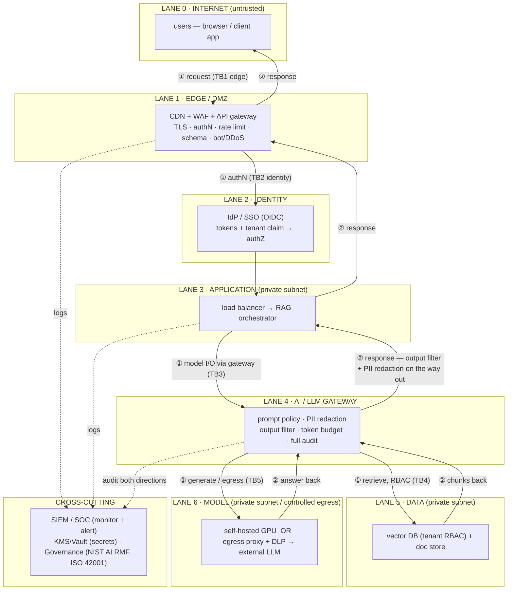

The response (②) flows back out through the AI gateway — where output filtering
and PII redaction act on what the model returns — then the edge; both directions
are logged to the SIEM. What enterprise adds over the lab, boundary by boundary:

- **Edge (TB1):** a **WAF + API gateway** — an L7 front door (schema validation,
  bot/DDoS, rate limits, TLS termination), not just an L3/4 firewall.
- **Identity (TB2):** real **SSO / OIDC** with per-user tokens and tenant claims,
  instead of one static API key. AuthN and tenant identity come from here.
- **AI / LLM gateway (TB3):** the big one — **all model I/O flows through one
  policy-and-audit chokepoint**: prompt-injection filtering, PII redaction,
  output filtering, per-tenant token budgets, and a full audit log. This is where
  most LLM-specific controls consolidate in a mature shop.
- **Data (TB4):** the vector DB enforces **tenant RBAC** (managed isolation), not
  just a query-level filter, on least-privilege creds.
- **Model (TB5):** either self-hosted serving *or* a **controlled egress with
  DLP** to an external provider — so sensitive context never leaves uninspected.
- **Cross-cutting:** a **SIEM / SOC** (an org-wide monitor+alert function, vs one
  sensor), **KMS / Vault** for secrets (vs a `.env`), and a **governance** mapping
  to NIST AI RMF / ISO 42001 for auditable compliance.

### Reading the spectrum

Same boundaries every time — untrusted→app, app→data, app→model, plus the wire.
Minimal drops the independent network layer and bets everything on the app.
Enterprise multiplies the boundaries and gives each its own dedicated chokepoint
and an org-level witness. A home lab sits in the middle on purpose: enough to
prove a network control *and* an independent witness, without enterprise sprawl.

## Other configurations: the axes you can change

The section above moved along one axis — network maturity. These are the *other*
axes, each independent, each shifting where the attack surface sits. A lab is one
point on every axis; the diagrams show the alternatives and what each costs.

### How the model gets its knowledge

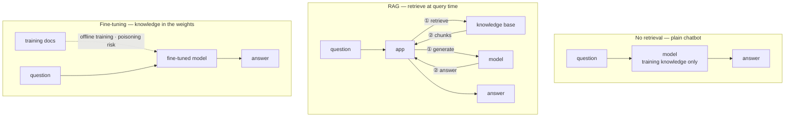

- **No retrieval:** knowledge only from training. Simplest, but no private or
  current data, and it will confidently invent answers (LLM09).
- **RAG:** knowledge retrieved at query time. Surface = the prompt and the
  retrieval; the model stays generic and swappable.
- **Fine-tuning:** knowledge baked into the weights by a training job. No
  retrieval and lower per-query cost, but the attack moves to the *training data*
  (poisoning, **LLM04**), the model can memorise and leak it, and an update means
  retraining.

### How much the model can do — agents, tools, and permissions

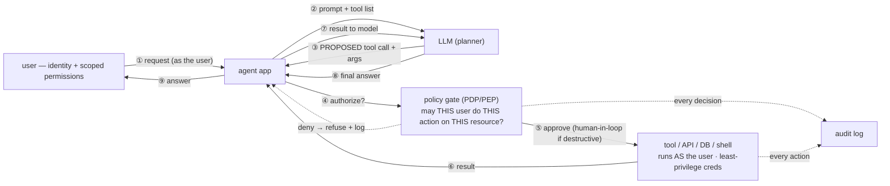

The moment the model can *call tools*, its output stops being text and becomes an
**action** — so a tool call the model proposes is a **request to be authorized,
never an instruction to auto-run.** Two different permission gates must exist,
and they are easy to conflate:

- **Read authorization** — what the agent may *see*: the tenant filter / RBAC on
  the vector DB (the retrieval boundary above). Governs retrieval.
- **Action authorization** — what the agent may *do*: a policy gate (PDP/PEP) in
  front of *every* tool call — *may THIS user perform THIS action on THIS
  resource?* Governs execution.

**Being privy to information is not permission to act on it.** A user cleared to
*read* a vulnerability finding is not thereby cleared to *remediate* — to execute
against — the target; that is a separate decision at a separate gate. The classic
failure is the **confused deputy**: the agent runs with its own powerful service
account, so a user coaxes it into an action they could never perform alone. The
fix is **delegated identity** — the agent acts *as the user* (on-behalf-of,
scoped), with least-privilege tool creds, so it can never exceed the user's own
authority. State-changing or destructive actions (patch, delete, "heal a
resource," run code) add a **human-in-the-loop approval**, and *every* tool
decision — allow or deny — is audited.

This is **LLM06 excessive agency**: the model's proposed action crossing into
real-world effect is its own trust boundary, the crossing that needs the
strongest control. Blast radius = whatever the tools can touch, so also keep a
tool allowlist and validate/sandbox arguments. A read-only RAG app sits at the
safe end of this axis — no tools, so this action layer isn't in play; it is
exactly what you would add, and threat-model, the moment the agent can act.

### Where the model runs

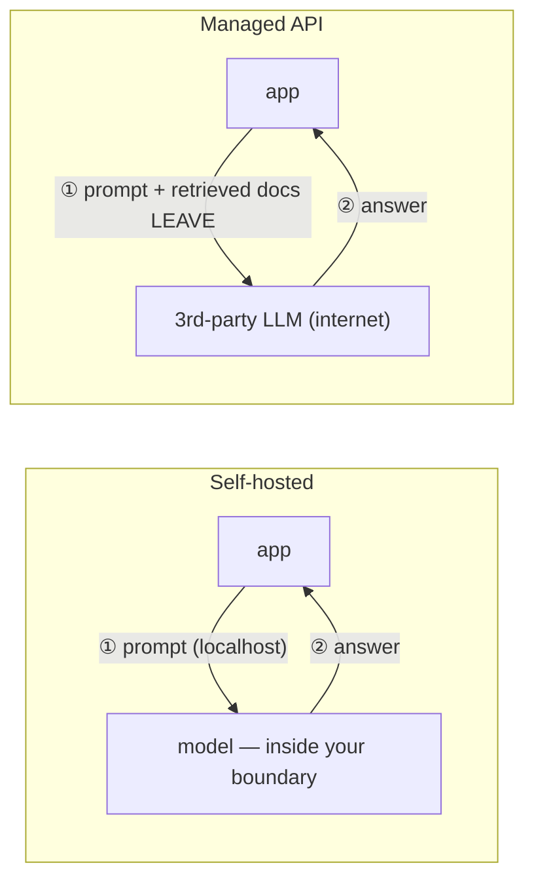

Self-hosted keeps prompts and documents inside your boundary (you own patching
and hardware). A managed API sends your prompt *and the retrieved documents* to a
third party — so you need egress control + DLP, you inherit the provider as
supply chain (**LLM03**), and data-retention terms matter.

### Where the guardrail sits

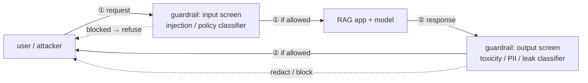

An in-prompt guard is one sentence — cheap but soft; experiments show it only
*reduces* injection. A separate guardrail service is an independent classifier
that screens the input (injection/policy) and the output (toxicity, PII, secret
leakage) on the way through — stronger and auditable, at the cost of latency, and
still just another control that can be incomplete.

### How tenants are isolated

| approach | isolation | overhead | failure mode |
| --- | --- | --- | --- |
| shared store + query filter | weakest — one bad filter leaks across tenants | lowest | RAG IDOR (LLM08) if the filter is dropped |
| namespace / collection per tenant | medium | medium | a misrouted namespace |
| database / instance per tenant | strongest | highest | mostly operational |

### Where you'd see each, in the wild

Customer service is the flagship **RAG** use case — facts change, so you update by
adding a document, never by retraining. Fine-tuning is for stable *style and
behavior*, not facts that move.

| configuration | where you'd see it |
| --- | --- |
| no-retrieval chatbot | generic assistants, model-wrapper demos, creative/writing tools |
| RAG | customer support, IT/HR helpdesks, "chat with your docs" (company wikis, Glean/Notion-style), legal & medical document Q&A — the enterprise default |
| fine-tuning | brand-voice assistants, domain/vertical models (finance, medical, house code style), on-device small models — stable behavior, not changing facts |
| agents / tools | coding assistants that edit & run (IDE agents), support bots that actually issue refunds / reset passwords / open tickets, booking & ops copilots |
| self-hosted model | finance, healthcare, defense, air-gapped, or cost-at-scale (self-hosted runtimes, on-prem GPU) |
| managed API | most startups and products (the major hosted LLM providers) |
| separate guardrail service | regulated / mature shops (dedicated guardrail / content-safety services) |
| per-tenant DB isolation | high-assurance multi-tenant SaaS (regulated verticals) |

Real products usually mix axes: a support bot is typically **RAG** (facts) +
maybe a **fine-tune** for brand voice + **tools** to act + a **managed or
self-hosted** model + a **guardrail service** — each axis chosen on its own.

### The whole picture

A deployment is one point on every axis: how it gets knowledge, how much it can
do, where it runs, where the guardrail sits, how tenants are isolated, and how
the network is built. Slide any axis and the threat model moves — which is why
the first question in a review is always *"which configuration is this, on each
axis?"* before judging whether the controls fit.

## Beyond the diagram: what else an architect checks on an AI system

The boundaries above cover the request path. These are the questions that don't
show up on a data-flow diagram and still decide whether the system is safe to
run. Grouped by when they bite.

### Supply chain and data

- **Model provenance.** Where did the weights come from, are they signed or
  hashed, what licence, what's in the model card? A downloaded model is a
  third-party binary you execute (LLM03).
- **Data lifecycle.** Classification of what goes into the corpus; consent and
  retention; and *deletion* — removing a document must also remove its vectors.
  Unlearning from fine-tuned weights is close to impossible; that lifecycle
  problem is a real reason RAG beats fine-tuning for regulated data.
- **Embeddings are sensitive data.** Vectors can be inverted back toward the
  text they came from, so the vector DB needs the same protection as the corpus
  (LLM08).
- **Prompts are config, sometimes secrets.** Version the system prompt, review
  changes to it like code, and treat its leakage as a finding (LLM07).

### Runtime

- **Output is untrusted input to whatever consumes it.** Encode it for HTML,
  parameterise it for SQL, never hand it to a shell or `eval` (LLM05).
- **Cost and abuse limits.** Per-tenant token budgets, request rate limits, time
  caps — this lab's DoS came from a single probe family (LLM10).
- **Fail closed.** When the model or the vector DB is down, what does the app
  do? A fallback that answers without the guard, or without the tenant filter,
  is a silent downgrade.
- **Logs are a new sensitive store.** The audit log holds prompts and answers —
  often PII. Access control, retention and redaction apply to it too.

### Operations

- **Continuous evaluation.** Red-teaming is a regression suite, not a one-off:
  the canaries and probe families run on every prompt or model change, and the
  rates are compared to the last run.
- **Change management.** Pin the model version, version the prompt, promote only
  after evaluation, keep the previous version ready to roll back to.
- **AI-specific observability.** Refusal rate, injection-signature hits,
  retrieval anomalies (cross-tenant hits, empty context), latency and error
  spikes, cost per tenant — alert on these, not only on CPU.
- **Incident response.** Playbooks for a prompt leak, a discovered poisoned
  document, a jailbreak campaign; a kill switch for the tools or the model path;
  the re-ingest procedure that cleans a corpus.
- **The red-team tool is itself a risk.** It sends real attack traffic, so it
  needs its own rail: only authorised targets, acknowledged explicitly — here,
  the scanner's private-target check and an explicit acknowledgement flag.

### Governance and people

- **Frameworks.** NIST AI RMF (Govern, Map, Measure, Manage) for the programme;
  ISO/IEC 42001 for the management system; OWASP LLM Top 10 as the checklist;
  MITRE ATLAS for the technique vocabulary; sector rules wherever regulated data
  crosses the model.
- **Automation bias.** People over-trust fluent output (LLM09). Label AI answers,
  show the sources retrieved, keep a human on anything consequential.
- **Separate environments.** Attack a snapshot you can revert, never the system
  of record — the lab's whole working method.

## What to read next

The milestone entries put numbers on these: the indirect-injection experiment
and the one-sentence guard proven by removing it; and the direct red-team of the
running app. See the journal index.

For the controls themselves — what a guardrail is at each layer, what to use
with no budget and with a full vendor stack, and a review checklist built as a
jump point rather than a spiral — see
[AI guardrails at three budgets, and a checklist](ai-guardrails-and-checklist.md).
