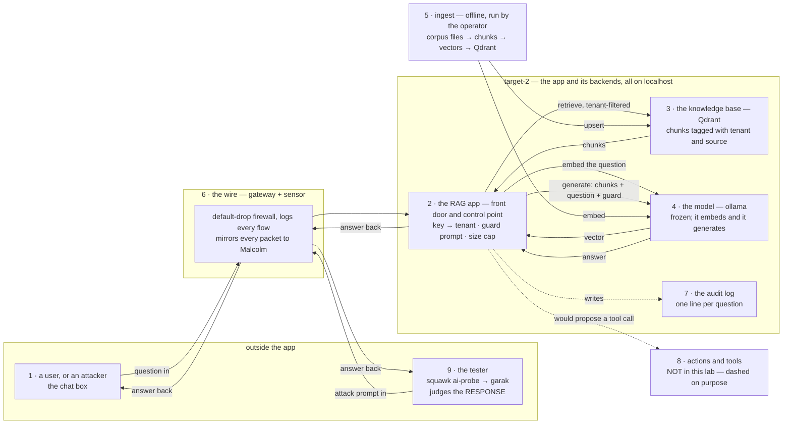

# Start here: the whole AI architecture in one place, in order

For anyone who has seen the pieces — a chatbot here, "RAG" there, a vector
database, a model, a red-team tool — and never the whole thing together. This
walks the architecture from zero in the order that makes each part make sense,
using a real, running lab as the example. Every module is one idea, the place it
lives in the picture, and one thing you can check yourself.

How to read it: one module at a time. Don't go deep until the module tells you
where deep is. Each ends with the question that leads to the next.

## Module 0 — The whole picture on one page

Nine numbered parts. Every later module zooms into one number — the numbers on
the boxes are an index, not an order; the order of one request is Module 3's
job. The arrows run both ways on purpose: a question goes in, the answer comes
back, and the answer is what gets judged.



| # | part | module | go deep |
| --- | --- | --- | --- |
| 1 | the user or attacker | 4, 6 | primer Part 2 |
| 2 | the RAG app | 4 | primer Part 2; checklist, Mechanisms 1 |
| 3 | the knowledge base | 2 | primer Part 2; checklist, Mechanisms 2 |
| 4 | the model | 1 | primer Part 1 |
| 5 | ingest | 2 | primer, "The ingest pipeline" |
| 6 | the wire and the sensor | 5 | primer Part 3; Searching Malcolm |
| 7 | the audit log | 3, 8 | checklist, Mechanisms 6 |
| 8 | actions (absent here) | 7 | primer 5.2; checklist, Mechanisms 5 |
| 9 | the tester | 9 | the garak entry in the journal |

## Module 1 — What the model is, and is not

**The idea.** The model is a finished, frozen brain somebody else trained. It
never learns from us. It supplies *language*; it does not hold our facts. Ask it
about our bakery and it knows nothing — unless we hand it the page.

**In this lab.** `llama3.2:3b`, served by ollama on target-2, bound to localhost.
Two jobs: turn text into numbers (embedding) and write answers (generation).

**See it yourself** (from Kali. `TARGET2` is the app host's address on the
target segment and `KEY` your tenant key; neither is written in this journal):

```text
curl -s -X POST "http://$TARGET2:8080/ask" \
  -H "Authorization: Bearer $KEY" -H 'Content-Type: application/json' \
  -d '{"question":"What is the capital of France?"}'
```

It answers that it does not know. It *could* answer — the model knows Paris —
but the app told it to use only the documents it was given, and no bakery
document mentions France. That one line is the difference between a chatbot and
a RAG app.

**Leads to:** if the model holds no facts, where are they?

## Module 2 — Where the knowledge lives

**The idea.** The facts are documents. Each document is cut into chunks, each
chunk is turned into a vector (a list of numbers that captures its meaning), and
the vectors are stored in a vector database tagged with who owns them. Finding
"the relevant page" is a nearest-neighbour search over those vectors.

**In this lab.** A folder of markdown files per tenant → chunks of about 800
characters → embedded by the model → stored in Qdrant, each point carrying the
tenant, the source file and the chunk index. The tenant comes from *which
folder* a file was loaded from, never from anything written inside the file.
Loading is an offline job the operator runs.

**See it yourself** (on target-2, where Qdrant listens on localhost only):

```text
curl -s http://127.0.0.1:6333/collections/<collection>/points/scroll \
  -H 'Content-Type: application/json' \
  -d '{"limit":1,"with_payload":true,"with_vector":false}'
```

One stored chunk: its text, its tenant, its source file, its index. That payload
is the whole basis of "who may see this."

**Leads to:** how does a question become a search, and a search become an
answer?

## Module 3 — One question, start to finish

**The idea.** Three calls, always in this order, because each needs the last:
embed the question (you cannot search without a vector), search the knowledge
base (you cannot answer without the pages), generate (chunks + question + the
rules). The model is called twice.

**In this lab.** The app's answer path is three calls — embed with the model,
search Qdrant, generate with the model — then one audit line. The sequence
diagram in the primer draws it; this is the shape to hold in your head:

```text
question → [embed] → vector → [search, filtered to your tenant] → chunks
        → [generate: chunks + question + guard] → answer → audit line
```

**See it yourself** (on target-2):

```text
tail -n 1 audit.jsonl | jq '{tenant, retrieved: [.retrieved[] | {tenant, source}], model, embed_model}'
```

Key: `tail -n 1` is the last question · `jq '{...}'` picks the fields that show
the three parts — which model embedded, which chunks came back and whose, which
model answered. The same line also records whether the tenant filter was on;
the field names are the app's own. (In Python this is `json.loads(line)` and a
dictionary; `jq` is the same idea at the shell.)

**Leads to:** who is allowed to ask, and what stops them seeing someone else's
pages?

## Module 4 — The front door and the control point

**The idea.** The app is the only part a caller touches, so it is where the
rules live: who you are, which tenant you belong to, how big a request may be,
and the sentence that tells the model to use only the documents. Every control
you can name sits either here or behind here.

**In this lab.** A Bearer key maps to a tenant, compared in constant time; a
wrong key is `401`; a body over 16 KiB is `413`; the guard prompt is hardcoded:
*"Answer the question using only the context below. If the context does not
contain the answer, say you do not know."* The tenant filter is a condition
inside the Qdrant query, so another tenant's chunks are never even ranked.

Notice one thing for later: the key *is* the tenant. There is no per-user
identity. Fine for a lab; a leaked key in a product would be a whole tenant.

**See it yourself** (from Kali):

```text
curl -s -o /dev/null -w '%{http_code}\n' -X POST "http://$TARGET2:8080/ask" \
  -H 'Content-Type: application/json' -d '{"question":"hi"}'
```

`401`. No key, no door.

**Leads to:** the app is on another machine. What happens to the request on the
way there, and who else sees it?

## Module 5 — The wire and the witness

**The idea.** Between the caller and the app sits a network, and in this lab
the network is a control too: a gateway that drops everything by default, logs
every new flow, and copies every packet to a sensor. The sensor is a **witness
the app cannot edit** — if the app is compromised and its own log lies, the
mirror still has the truth. Both directions are plaintext here, so the witness
sees the attack *and* the answer.

**In this lab.** Kali → gateway → target-2 on port 8080; the gateway's
`nftables` ruleset and its `tc mirred` mirror; Malcolm on the management
network reading the mirror. Addresses are not written in this journal.

**See it yourself — the three-record test.** Send one question, then find it in
three places: the app's audit line (Module 3), the gateway's flow log, and
Malcolm (search `destination.port: 8080` for the minute you sent it — the
*Searching Malcolm* primer gives the exact steps). One event, three independent
records. If any is missing, that witness is not a witness.

**Leads to:** now that you can see every part, where does an attacker push?

## Module 6 — What can go wrong, and where

**The idea.** Because the model is frozen, nobody attacks its weights. They
attack the *app*: what goes into the prompt, what the retrieval returns, what
comes out, and — if the model can act — what it does. Each has a name in the
OWASP LLM Top 10, and each landed somewhere in this lab.

| the push | where it lands | OWASP | what this lab found |
| --- | --- | --- | --- |
| type the attack in the chat box (direct injection, jailbreak) | 1 → 2, the prompt | LLM01 | jailbreaks landed 98–100%; direct injection 55% |
| plant an instruction in a document for a later question to pull back (indirect) | 5 → 3 → 2 | LLM01 | one canary in three fired with no guard; none with it |
| get the model to repeat its own rules | 2 → 4 | LLM07 | resisted, 0 of 256 |
| read another tenant's documents | 3, the filter | LLM08 | the filter is inside the query; the audit line proves it per hit |
| make the output dangerous to whatever renders it | 4 → 2 → 1 | LLM05 | no output check exists — open |
| exhaust the model | 4 | LLM10 | one probe family of thousands of prompts 502'd it |
| make the model *do* something | 8 | LLM06 | no tools — not in play, by design |

**Leads to:** if those are the doors, where do the locks go?

## Module 7 — Where the controls go

**The idea.** Draw a line wherever data crosses from a less-trusted place into
a more-trusted one. Each line is a **trust boundary**, and every boundary needs
three kinds of control: something set in advance that prevents (configuration),
something that watches continuously (monitoring), and something that fires
(alerting). The lab's boundaries, top to bottom:

```text
untrusted input  ── TB1 ──  the app      (key, guard, size cap)
                 ── TB2 ──  the wire     (firewall, mirror, sensor)
the app          ── TB3 ──  retrieval    (tenant filter inside the query)
the app          ── TB4 ──  the model    (guard, caps, localhost only)
operator files   ── TB5 ──  ingest       (ownership from the load path)
```

And one distinction people miss until it hurts: **permission to read is not
permission to act.** Being allowed to *see* a finding is a read filter (TB3).
Being allowed to *fix the server* is a separate decision at a separate gate,
made as the user, with approval for anything destructive. This lab has no
actions, so that gate does not exist here yet — which is why part 8 is dashed.

**See it yourself.** The primer's lab gap table lists each control with whether
it exists today and how it is verified on the running system. Read it as a
newcomer would: the "no" rows are not failures, they are the backlog.

**Leads to:** how do you *know* a control works, instead of believing it does?

## Module 8 — Proved, not asserted

**The idea.** A control is not a control because it is written down. It is a
control when you can show it holding — and the honest way to show that is to
remove it and watch the attack succeed. Three habits:

- **Remove it and measure.** Milestone 5 ran the same planted documents with the
  guard sentence and without. Without: one canary in three fired. With: none.
  That turned "the prompt probably helps" into "the prompt is load-bearing."
- **Coverage before conclusion.** A canary the retrieval never returned proves
  nothing. A scan that reached one of four probe families is a floor, not a
  verdict — the tester says so now, in so many words.
- **Live, not source.** The tenant filter is a flag. The proof it is on is the
  audit field that records it on every request — not the line of code.

**See it yourself** (on target-2; `filter_on` stands for whatever your app
names the flag; it must print nothing):

```text
jq -c 'select(.filter_on != true)' audit.jsonl
```

**Leads to:** who does the attacking, and how do you read what they report?

## Module 9 — The tester

**The idea.** The thing under test is the app. The thing doing the testing is a
separate client that sends attacks and **judges the answers**. Four words carry
the tool: a *generator* (the target it talks to), a *probe* (an attack, or a
family of them), a *detector* (how it decides whether the attack landed), and
the *report*. And one trap: its verdict is written from the defender's side —
`FAIL` means the model *failed to resist*, which is a finding.

**In this lab.** squawk's `ai-probe` writes a config for the app's `/ask`,
runs garak's four families (`promptinject`, `latentinjection`, `dan`,
`sysprompt_extraction`), reads the report, and turns each probe's attack-success
rate into a prioritised finding — and it reports *which families actually ran*,
so a cut-off scan cannot read as a clean one. It only attacks a private or
explicitly acknowledged target: the tester has its own rail.

**See it yourself** (any run's `raw/garak.report.jsonl`):

```text
grep '"entry_type": "eval"' garak.report.jsonl | head -n 1 \
  | jq '{probe, detector, resisted: .passed, of: .total_evaluated, attack_success: .hit_at_k["1"].score}'
```

One record: which attack, which judge, how many it resisted out of how many,
and the success rate garak scored on the answers.

**Leads to:** this is one lab. What changes when the system is bigger, or has
no gateway, or can act?

## Module 10 — Beyond this lab

Everything above is one point on several dials: a RAG app (not fine-tuned,
not a plain chatbot), read-only (no tools), self-hosted (not a hosted API), a
one-sentence guard (not a guardrail service), one shared store with a filter
(not a database per tenant), behind a gateway (not flat, not enterprise). Turn
any dial and the threat model moves. The primer draws every setting of every
dial; the checklist tells you what to put where at three budgets.

Read next, in this order:

1. **RAG apps: what they are, and how we test them** — the primer; all the
   diagrams, the three postures, the axes.
2. **AI guardrails at three budgets, and a checklist** — what each control
   looks like as a config block, a query, a rule, or a log field; and the
   checklist you can run on any system in an afternoon.
3. **The milestone entries** — the numbers, and what each control measured when
   it was removed.
4. **Searching Malcolm** — how to read the witness.

## Glossary — one line each

- **agent / tool-calling** — a setup where the model's output can trigger an action (an API call, a command), not just text.
- **attack-success rate** — of the attacks sent, the share the model did not resist; garak reports it per probe.
- **audit log** — one record per request, written by the app: who asked, what came back from retrieval, which controls were on, what was answered.
- **authN / authZ** — proving who you are / deciding what you may do. Different gates.
- **canary** — a harmless planted marker (a word that could never appear by chance) that proves an attack landed if it shows up.
- **chunk** — a slice of a document small enough to embed and retrieve on its own.
- **confused deputy** — a service acting with its own powerful credentials on behalf of a user who could not do that thing alone.
- **context** — the text placed in the prompt for one question: the retrieved chunks plus the rules.
- **detector** — garak's judge: the rule that decides whether an answer shows the attack worked.
- **direct / indirect injection** — attack text typed into the request / attack text planted in data the app will later retrieve.
- **embedding** — a document chunk or a question turned into a vector of numbers that captures its meaning.
- **fine-tuning** — changing a model's weights with more training; the opposite approach to RAG.
- **generator** — garak's word for the target it sends prompts to.
- **grounding** — an answer that is supported by the retrieved text, not invented.
- **guard prompt** — the sentence in the system prompt that tells the model to use only the context.
- **guardrail** — any control on what goes in, what is retrieved, what comes out, or what the system may do.
- **inference** — using a finished model to answer; the weights do not change.
- **jailbreak** — a prompt that talks the model out of its rules.
- **knowledge base** — the company's documents, embedded and stored; the facts.
- **LLM** — large language model; the frozen brain that supplies language.
- **mirror (span)** — a copy of every packet on a network segment, sent to a sensor.
- **OWASP LLM Top 10** — the standard list of LLM application vulnerabilities (LLM01 prompt injection … LLM10 unbounded consumption).
- **MITRE ATLAS** — the catalogue of adversary techniques against AI systems, the AI counterpart of ATT&CK.
- **PDP / PEP** — the component that decides a permission question / the one that enforces the decision.
- **probe** — garak's word for an attack, or a family of related attacks.
- **prompt** — the full text the model receives: system rules, retrieved context, the question.
- **provenance** — where a document came from and who owns it, recorded with it.
- **RAG** — retrieval-augmented generation: look up the relevant documents for each question and put them in the prompt.
- **refusal** — the model declining to answer; a drop in the refusal rate is a signal.
- **retrieval** — the search step that returns the chunks most similar to the question.
- **system prompt** — the rules the app gives the model before the user's question.
- **tenant** — one customer's isolated slice of data in a shared system.
- **top-k** — how many chunks retrieval returns (four, here).
- **trust boundary** — a line where data crosses from a less-trusted zone to a more-trusted one; where controls go.
- **vector / vector database** — a list of numbers representing meaning / a store that searches by nearness between them.
- **weights** — the numbers inside a model that training sets and inference leaves alone.
